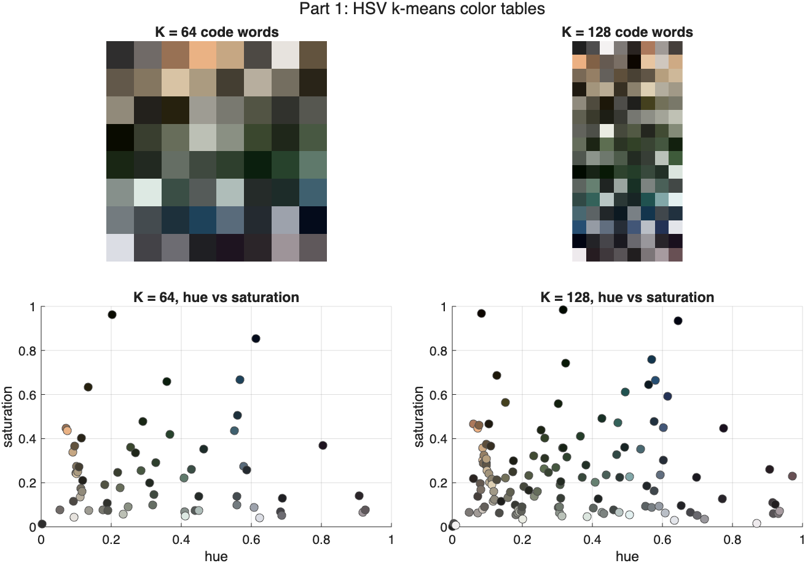
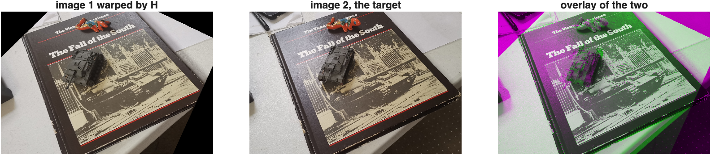

# HW1: Color Histograms and Homography

Two separate parts. Part 1 learns an HSV color codebook with k-means and uses the resulting histograms to classify aerial scenes. Part 2 estimates a homography between two image pairs from SIFT matches, solving Ah = 0 with the SVD.

MATLAB R2025b, with the Image Processing, Computer Vision, and Statistics and Machine Learning toolboxes.

## Part 1: HSV color histograms

600 images, the first 15 classes of NWPU-RESISC45 at 40 images each. k-means over 500 HSV pixels sampled from every image gives a codebook of K = 64 or 128 colors. Each image turns into a normalized histogram over that codebook, with pixels assigned by either Euclidean distance or KL divergence. Classification is 1-NN under two protocols: the 10/30 split from the assignment, and leave-one-out over all 600.

### Result

**60.5%**, at K = 128 with KL assignment and a chi-square classifier metric. Chance is 6.7%.

Three things came out of the experiment:

- K = 128 is no better than K = 64. Leave-one-out gives 52.5% either way, and a paired McNemar test splits the disagreements 45 to 45, p = 1.000.
- The distance the classifier uses matters more than anything about the features. Chi-square in place of Euclidean is worth 6 to 7 points at p < 0.001.
- Euclidean and KL pixel assignment cannot be told apart, p = 0.096. KL histograms are flatter, using 54 of 64 bins against 46.3, but flatter did not mean worse.

Per-class leave-one-out accuracy runs from 22.5% for basketball_court up to 95% for forest. Nothing lands at chance, so color carries some signal for all 15 classes.



The codebook is mostly desaturated earth, olive and slate tones, which is why doubling K buys nothing. Aerial imagery at this resolution has little color to spend.

## Part 2: Homography by SVD

Each correspondence contributes two rows to A, so eight matches give a 16 by 9 system. The solution to Ah = 0 is the right singular vector belonging to the smallest singular value, reshaped to 3 by 3. Verified by warping the first image into the second one's frame with `imtransform`.

### Result

| Pair | Matches | H agrees with | Median error |
| --- | --- | --- | --- |
| sift-1.jpg to sift-2.jpg | 949 | 796 (83.9%) | 1.08 px |
| sift-3.png to sift-4.png | 276 | 89 (32.2%) | 8.22 px |

Picking the "best" 8 matches by descriptor distance does not work. On pair 1 those eight contain a duplicated source point, sit inside a third of the frame, and include four outliers. The homography they produce misses its own eight points by 249 px and agrees with 1 match out of 949. The SVD says so in advance: the ratio s9/s8 is 0.21, meaning there is no clean null direction. Requiring the eight points to be spread out and mutually consistent drops that ratio to 0.018 and takes agreement to 796.



The 32% on pair 2 is the scene, not the estimate. A homography is exact only for a plane. Pair 1 is a flat book cover, so almost everything obeys one transform except the toy tank sitting on it. Pair 2 is aerial, where the ground is flat but the buildings stand above it, so roof points cannot follow the ground plane. Both solutions recover nearly everything a robust fit finds, 99% and 94% of the RANSAC inlier set.

## Files

| File | What it does |
| --- | --- |
| **Part 1** | |
| `getHSVColorTable.m` | k-means HSV codebook, assignment signature |
| `getHSVHist.m` | histogram feature with `'euc'` and `'kld'`, assignment signature |
| `knnclassify.m` | stand-in for the function removed from MATLAB after R2013b |
| `hw1_config.m` | defines the 600-image, 15-class subset |
| `hw1_part1_colortable.m` | trains and plots both codebooks |
| `hw1_part2_hist.m` | builds the four feature matrices |
| `hw1_part2_figs.m` | histogram and class-mean figures |
| `hw1_part3_recog.m` | both protocols, accuracy tables, confusion matrix |
| **Part 2** | |
| `getHomographySVD.m` | builds A, solves Ah = 0 with the SVD |
| `hw1_part2_homography.m` | SIFT, matching, both 8-point selections, warps |
| `hw1_part2_export.m` | writes the numbers to JSON for the report |
| **Checks** | |
| `hw1_verify.m` to `hw1_verify5.m` | 30 checks against independent implementations |
| **Data and output** | |
| `NWPU-RESISC45/` | the 600 images used, 15 classes of 40 |
| `sift-1.jpg`, `sift-2.jpg` | provided pair |
| `sift-3.png`, `sift-4.png` | second pair |
| `*.mat` | codebooks, feature matrices, saved results |
| `results/` | every figure in the report |
| `hw1-report.docx` | the submitted write-up |

The `part1`, `part2`, `part3` in the Part 1 filenames refer to the three objectives of the color histogram section, not to Part 2 of the assignment. `hw1_part2_homography.m` is the homography one.

## Running it

`cd` into this folder in MATLAB, then:

```matlab
>> hw1_part1_colortable    % k-means codebooks, about 2 min the first time
>> hw1_part2_hist          % the four feature matrices
>> hw1_part2_figs          % Part 1 figures
>> hw1_part3_recog         % classification, tables, confusion matrix
>> hw1_part2_homography    % SIFT, homography, warps
```

The `.mat` files are checked in, so each script skips work that is already done. Delete them to force a rebuild. Every seed is fixed with `rng(0)`, so the numbers reproduce exactly.

To check the results rather than trust them:

```matlab
>> hw1_verify      % dataset integrity and getHSVHist against brute force
>> hw1_verify2     % knnclassify against fitcknn, split integrity
>> hw1_verify3     % leave-one-out and McNemar significance
>> hw1_verify4     % the specific claims made in the report
>> hw1_verify5     % homography code against a known answer
```

`hw1_verify5` plants a homography, runs it through `getHomographySVD` and checks it comes back to 1e-9. `hw1_verify2` confirms the `knnclassify` stand-in agrees with `fitcknn` on 100% of predictions.

`checkcode` flags `maketform` and `imtransform` as not recommended. The assignment asks for `imtransform` specifically, so that warning is expected.

## Dataset

`NWPU-RESISC45/` here holds only the 600 images the assignment uses. The full set is 45 classes of 700 and is on [Kaggle](https://www.kaggle.com/datasets/aqibrehmanpirzada/nwpuresisc45).

## AI Use Disclosure

Anthropic Claude Code was utilized on this assignment. Its contributions were: writing the MATLAB implementations and the verification scripts, generating the figures, and drafting the report text. I set the direction, chose the approach and the second image pair, edited the write-up, and reviewed and ran everything before submitting.

## Documentation Referenced

Part 1:

- `kmeans` - https://www.mathworks.com/help/stats/kmeans.html
- `rgb2hsv` - https://www.mathworks.com/help/matlab/ref/rgb2hsv.html
- `pdist2` - https://www.mathworks.com/help/stats/pdist2.html
- `fitcknn` - https://www.mathworks.com/help/stats/fitcknn.html
- `confusionchart` - https://www.mathworks.com/help/stats/confusionchart.html

Part 2:

- `detectSIFTFeatures` - https://www.mathworks.com/help/vision/ref/detectsiftfeatures.html
- `extractFeatures` - https://www.mathworks.com/help/vision/ref/extractfeatures.html
- `matchFeatures` - https://www.mathworks.com/help/vision/ref/matchfeatures.html
- `svd` - https://www.mathworks.com/help/matlab/ref/double.svd.html
- `maketform` - https://www.mathworks.com/help/images/ref/maketform.html
- `imtransform` - https://www.mathworks.com/help/images/ref/imtransform.html
- `estgeotform2d` - https://www.mathworks.com/help/vision/ref/estgeotform2d.html
