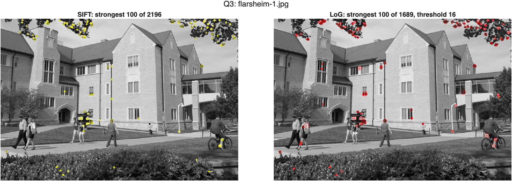
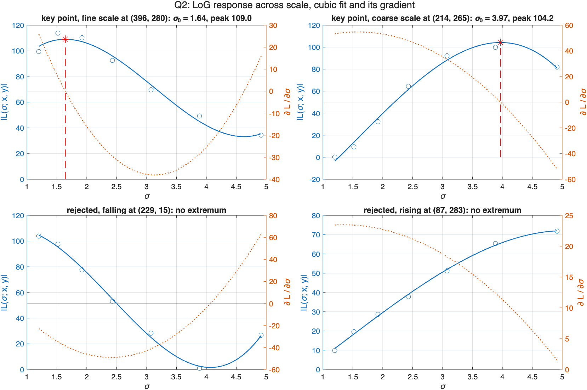

# HW2: Key Points from a LoG Pyramid

Detects key points as extrema of a scale-normalized Laplacian of Gaussian over position and scale, then compares them with SIFT, which finds the same extrema through a difference of Gaussians.

MATLAB R2025b, with the Image Processing, Computer Vision, and Statistics and Machine Learning toolboxes.

## Method

The pyramid is seven LoG responses at sigma = 1.200, 1.518, 1.920, 2.429, 3.072, 3.886 and 4.915, each multiplied by sigma squared so that levels can be compared. All levels keep the size of the image.

A pixel is a key point when it passes three tests:

1. The largest of its seven response magnitudes is at least the threshold, in gray levels on 0 to 255.
2. On the level where it responds most, it is larger than all 26 neighbors in the 3 by 3 by 3 block around it.
3. A cubic fitted to its seven responses with `polyfit` has a maximum inside the scale range. The maximum is found by solving f' = 0 and checking f'' < 0. The fitted scale also has to be within one level of the level tested in step 2.

The scale of a key point is the root of the gradient, so it is continuous and not one of the seven levels.

## Result

| Image | LoG key points | SIFT in the same scale range | LoG with a SIFT point within 3 px | Chance |
| --- | --- | --- | --- | --- |
| flarsheim-1.jpg | 1689 | 1165 | 49.3% | 13.5% |
| sift-1.jpg | 3544 | 1631 | 36.3% | 7.0% |
| sift-3.png | 1361 | 1643 | 69.7% | 13.7% |

LoG at a threshold of 16, SIFT from `detectSIFTFeatures` at its defaults. Chance is the same count against the SIFT points mirrored left to right.

Four things came out of it:

- The gradient test is what makes this a scale space detector. On flarsheim-1.jpg 6068 pixels are strong local maxima and only 29.1% of them have a peak across scale. Most of the rest respond most at sigma = 1.2 and are still falling.
- Most of the disagreement with SIFT is edges. SIFT drops points whose principal curvatures differ by more than 10 to 1 and the LoG detector does not. 29% and 45% of the LoG points on the first two images fail that test, and those match SIFT at the chance level, 12.1% and 7.2%. Points that pass match 60% to 73% of the time.
- The scales agree up to a constant. Rank correlation is 0.80 to 0.91 and the LoG scale is 1.17 times the SIFT scale. On synthetic blobs of known size the LoG fit returns 0.98 to 1.06 times the true size and SIFT returns 0.87 to 0.89.
- The difference of Gaussians is ln(k) times the scale-normalized LoG. Measured slope 0.234 against ln(k) = 0.235, at a correlation of 1.0000.



The strongest 100 key points of each detector. They go to the same leaves, windows and sign.



Four pixels and their cubic fits. The top two have a zero of the gradient inside the range and are key points. The bottom two do not.

## Files

| File | What it does |
| --- | --- |
| **Functions** | |
| `getLoGPyramid.m` | Q1, the scale-normalized LoG pyramid, assignment signature |
| `getScaleResponseExtrema.m` | Q2, cubic fit and extremum by the gradient, assignment signature |
| `getLoGKeyPoints.m` | Q3, image level detection, assignment signature |
| `hw2_config.m` | scales, images, threshold and comparison settings |
| **Scripts** | |
| `hw2_q1_pyramid.m` | builds the pyramid, per-level table and figure |
| `hw2_q2_extrema.m` | fits four example pixels, measures fit quality over the image |
| `hw2_q3_keypoints.m` | detection on three images, every SIFT comparison |
| `hw2_q3_export.m` | writes the numbers to JSON for the report |
| **Checks** | |
| `hw2_verify.m` | 51 checks against cases with a known answer |
| **Data and output** | |
| `flarsheim-1.jpg` | provided image |
| `sift-1.jpg`, `sift-3.png` | two more, from Homework 1 |
| `*.mat` | saved results |
| `results/` | every figure in the report, and `hw2_numbers.json` |
| `hw2-report.docx` | the submitted write-up |

## Running it

`cd` into this folder in MATLAB, then:

```matlab
>> hw2_q1_pyramid      % pyramid and its figure
>> hw2_q2_extrema      % cubic fits and fit quality
>> hw2_q3_keypoints    % detection and SIFT comparison, a few seconds
>> hw2_q3_export       % numbers to JSON
```

Nothing is random in the detector, so the key points reproduce exactly. The timings in the results change from run to run.

To check the results:

```matlab
>> hw2_verify
```

It compares the pyramid with a LoG kernel written out from its formula, checks a Gaussian blob against the closed form of its response, recovers the maximum of a known cubic to 1e-9, compares the gradient method with the grid search in the provided reference code, and runs the detector on synthetic blobs of known position and size.

## SIFT baseline

The assignment uses `vl_sift` from VLFeat. VLFeat is not installed here, so the comparison uses `detectSIFTFeatures`. Its ContrastThreshold is not in the same units as the peak threshold of `vl_sift`, so the two detectors are compared on all their points and on the strongest K of each, not at matching thresholds.

## AI Use Disclosure

Anthropic Claude Code was utilized on this assignment. Its contributions were: assisting with the MATLAB implementations and generating figures. I set the direction, chose the SIFT baseline and the test images, and reviewed and ran everything before submitting.

## Documentation Referenced

- `fspecial` - https://www.mathworks.com/help/images/ref/fspecial.html
- `imfilter` - https://www.mathworks.com/help/images/ref/imfilter.html
- `polyfit` - https://www.mathworks.com/help/matlab/ref/polyfit.html
- `polyder` - https://www.mathworks.com/help/matlab/ref/polyder.html
- `roots` - https://www.mathworks.com/help/matlab/ref/roots.html
- `imregionalmax` - https://www.mathworks.com/help/images/ref/imregionalmax.html
- `detectSIFTFeatures` - https://www.mathworks.com/help/vision/ref/detectsiftfeatures.html
