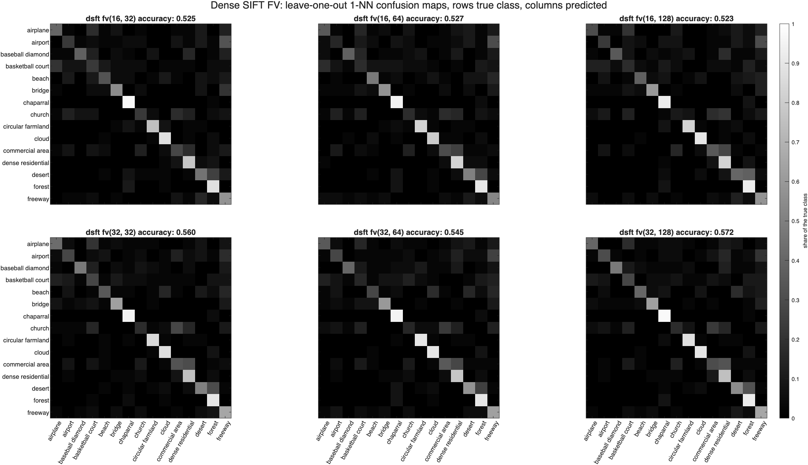

# HW3: Gradient Features with Fisher Vector and VLAD Aggregation

Describes each of the 600 aerial images by its local gradient features, SIFT, dense SIFT or HoG, aggregates them into one vector per image with a Fisher vector or VLAD over a PCA-reduced GMM, and compares every combination by leave-one-out 1-NN recognition.

MATLAB R2025b, with the Image Processing, Computer Vision, and Statistics and Machine Learning toolboxes.

## Method

The data set is the one from Homework 1, the first 40 images of the first 15 classes of NWPU-RESISC45.

Three local features per image:

- **SIFT**, key points from `detectSIFTFeatures` described by `extractFeatures`. 128-d, 7 to 2630 per image.
- **Dense SIFT**, the same 4 by 4 by 8 histogram computed upright on an 8 px grid with a 32 px window, written the way `vl_dsift` does it. 128-d, 784 per image.
- **HoG**, the 2 by 2 cell blocks of `extractHOGFeatures` at 8 px cells, kept as separate local features. 36-d, 961 per image.

100 features are sampled from every image, or all of them when an image has fewer, 59,145 SIFT and 60,000 of the other two. PCA of that sample gives A, and a diagonal GMM is fitted to it after reducing to kd = 16 or 32 dimensions, with nc = 32, 64 or 128 components. That is 18 models. The models never see a label.

Each image becomes a Fisher vector, the gradient of the GMM log likelihood with respect to the means and deviations, 2 kd nc long, or a VLAD vector, the sum of residuals to the nearest GMM mean, kd nc long. Both get a signed square root and unit L2 norm. Recognition is 1-NN with `knnclassify`, leaving each of the 600 images out in turn. Chance is 6.7%.

## Result

Leave-one-out 1-NN accuracy, best kd and nc of each feature. Chance is 6.7%.

| Feature | Fisher vector | VLAD |
| --- | --- | --- |
| SIFT | 53.7% (kd 16, nc 32) | 50.2% (kd 32, nc 32) |
| Dense SIFT | **57.2%** (kd 32, nc 128) | 50.5% (kd 32, nc 64) |
| HoG | 49.5% (kd 16, nc 32) | 43.3% (kd 16, nc 64) |

All 36 numbers are in `hw3-report.docx` and `results/hw3_numbers.json`.

Five things came out of it:

- Dense SIFT with a Fisher vector is the best combination. It is significantly better than HoG, p < 0.001 by McNemar's test, but its lead over SIFT is not, p = 0.14.
- The normalization matters more than anything else. The signed square root and L2 norm add 11.7 to 16.8 points to the Fisher vector and up to 22 to VLAD.
- The Fisher vector beats VLAD in all 18 models, by 5.4 points on average, significantly in 14.
- A bigger GMM does not help 1-NN. 32 against 128 components is not significant. kd does matter, up for dense SIFT, whose PCA spectrum is flat, and down for HoG, which has only 36 dimensions.
- Gradients and color do about equally well overall but on different classes. Dense SIFT beats the Homework 1 color histogram on bridge and freeway by 17.5 and 27.5 points and loses on church and commercial_area by 35 and 25. 76.3% of images are right under at least one feature.



The six dense SIFT maps. chaparral, forest, cloud and circular_farmland are easy everywhere. commercial_area and church go to dense_residential and desert to forest.

## Files

| File | What it does |
| --- | --- |
| **Functions** | |
| `getImageFeatures.m` | Q1, SIFT, dense SIFT and HoG, assignment signature |
| `getFisherVectorModel.m` | Q2, PCA and diagonal GMM, assignment signature |
| `getFisherVector.m` | Q3, Fisher vector aggregation, assignment signature |
| `getVLAD.m` | Q4, VLAD aggregation, assignment signature |
| `hw3_loo.m` | leave-one-out 1-NN, accuracy and confusion matrix |
| `hw3_confusion_figure.m` | the six confusion maps of one feature |
| `knnclassify.m` | stand-in for the removed function, from Homework 1 |
| `hw3_config.m` | images, labels, kd, nc and the other shared settings |
| **Scripts** | |
| `hw3_q1_features.m` | features of all 600 images, saves `gradient_features.mat` |
| `hw3_q2_gmm.m` | PCA, eigenvalue figure, the 18 GMMs |
| `hw3_q3_fisher.m` | Fisher vectors, accuracy tables, confusion maps, significance |
| `hw3_q4_vlad.m` | VLAD, the same, and the comparison with Fisher vectors |
| `hw3_export.m` | writes the numbers to JSON for the report |
| **Checks** | |
| `hw3_verify.m` | 41 checks against known answers and second implementations |
| **Data and output** | |
| `NWPU-RESISC45/` | the 600 images, 15 classes of 40, the same as Homework 1 |
| `*.mat` | models and saved results |
| `results/` | every figure in the report, and `hw3_numbers.json` |
| `hw3-report.docx` | the submitted write-up |

`gradient_features.mat` is the file the assignment asks for, the cell arrays `f_sift`, `f_dsift` and `f_hog`. It is 156 MB, over GitHub's file limit, so it is not checked in. `hw3_q1_features` rebuilds it in about 25 seconds.

## Running it

`cd` into this folder in MATLAB, then:

```matlab
>> hw3_q1_features    % features of all 600 images, about 25 s
>> hw3_q2_gmm         % PCA and the 18 GMMs, about 20 min
>> hw3_q3_fisher      % Fisher vector recognition
>> hw3_q4_vlad        % VLAD recognition
>> hw3_export         % numbers to JSON
```

The feature and model `.mat` files are reused when they exist. Delete them to force a rebuild. The sample and the GMM fits are seeded with `rng(0)`, so the numbers reproduce exactly.

To check the results:

```matlab
>> hw3_verify
```

It checks dense SIFT against a step edge and against the same image rotated 90 degrees, HoG against per-point extraction, the GMM fit against a mixture of known parameters, `getFisherVector` and `getVLAD` against loops written out from the definitions, and that the reported accuracies reproduce.

## VLFeat

The assignment is written around `vl_dsift`, `vl_gmm`, `vl_fisher` and `vl_vlad`. VLFeat does not run on Apple Silicon MATLAB, so each one is replaced: dense SIFT is written out here, `fitgmdist` fits the GMM, and the Fisher vector and VLAD are implemented directly from their definitions and checked against loop versions. `princomp` was removed from MATLAB and `pca` takes its place.

## AI Use Disclosure

Anthropic Claude Code was utilized on this assignment. Its contributions were: reviewing the MATLAB implementations and the verification script, reviewing the figures, and aiding with the report text. I set the direction and reviewed and ran everything before submitting.

## Documentation Referenced

- `detectSIFTFeatures` - https://www.mathworks.com/help/vision/ref/detectsiftfeatures.html
- `extractFeatures` - https://www.mathworks.com/help/vision/ref/extractfeatures.html
- `extractHOGFeatures` - https://www.mathworks.com/help/vision/ref/extracthogfeatures.html
- `imgradientxy` - https://www.mathworks.com/help/images/ref/imgradientxy.html
- `pca` - https://www.mathworks.com/help/stats/pca.html
- `fitgmdist` - https://www.mathworks.com/help/stats/fitgmdist.html
- `confusionmat` - https://www.mathworks.com/help/stats/confusionmat.html
- `vl_fisher` - https://www.vlfeat.org/matlab/vl_fisher.html
- `vl_vlad` - https://www.vlfeat.org/matlab/vl_vlad.html
