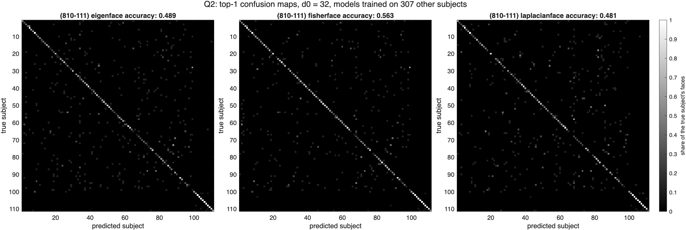

# HW4: Subspace Methods for Face Recognition

Eigenface (PCA), Fisherface (LDA) and Laplacianface (LPP) models of 20 by 20 faces, compared on top-1 recognition, on retrieving my own face, and as local models built from a query's nearest neighbors.

MATLAB R2025b, with the Image Processing, Computer Vision, and Statistics and Machine Learning toolboxes.

## Method

The data set is 6680 faces of 417 subjects. Ten photos of Barack Obama from Wikimedia Commons are added as subject 418, and 15 photos of me, ID 14387365, are kept apart for Q3. Both are cropped by `getFaceCrop`, which finds the largest face with the Viola-Jones detector, crops a square around it and stretches it to [0, 1] at 20 by 20.

The models are trained on the 5880 faces of the 307 subjects that are not in the first 800 faces and are not the celebrity, so Q2 and Q3 test them on people they have never seen. A0 is the first 32 principal directions. A1 solves Sb a = lambda Sw a in that space. A2 solves X'LX a = lambda X'DX a on the centered faces, with a heat kernel affinity W kept only within a subject, as in the course's `laplacianface.m`.

- Q2 recognizes each of the first 800 faces and the celebrity's 10 by its nearest other face.
- Q3 queries a database of the first 400 faces and 10 of mine with my other 5 faces.
- Q4 represents every face by a 16-dimensional PCA, finds the K = 100, 200 or 400 nearest faces of a query with a kd-tree, trains a local Eigenface and Fisherface model on them, and compares the local models by Cauchy-Binet distance.

## Result

| Model | Q2 top-1, unseen subjects | Q2 top-1, trained on the test faces | Q3 mAP@5 |
| --- | --- | --- | --- |
| Eigenface | 48.9% | 43.5% | 0.10 |
| Fisherface | **56.3%** | 76.5% | 0.00 |
| Laplacianface | 48.1% | 43.6% | 0.17 |

810 faces of 111 subjects, chance under 1%. Q3 mAP@5 follows the assignment's example; by the course slide's definition it is 0.02, 0.00 and 0.03.

Five things came out of it:

- Fisherface is the only model clearly better than Eigenface, p < 1e-8 by McNemar's test. Laplacianface and Eigenface cannot be told apart, p = 0.65.
- Laplacianface peaks at 12 directions with 48.6% and then falls back, while Fisherface keeps improving to 32. Checking against the provided `LPP.m` showed my first version was missing its mean subtraction, which put a direction with no information first.
- Cosine distance lifts Eigenface from 48.9% to 56.7%, level with Fisherface, so much of what Fisherface learns is to ignore lighting.
- Retrieving my own face fails, and not because of the code. Two of my photos are 6.12 apart in pixels, further than two different people in the data set, 4.96, because the data set's subjects were each photographed in one session and my photos span years and lighting.
- A local Fisherface model built from a query's neighbors is right 92% of the time against 85% for the local Eigenface model and the global nearest neighbor, at every K.



## Files

| File | What it does |
| --- | --- |
| **Functions** | |
| `getEigenface.m` | Q1, PCA model A0, assignment signature |
| `getFisherface.m` | Q1, LDA model A1 on top of A0, assignment signature |
| `getLaplacianface.m` | Q1, LPP model A2 and affinity W on top of A0, assignment signature |
| `getAveragePrecision.m` | Q3, AP as in the assignment's example and as on the course slide |
| `getGrassmannDistance.m` | Q4, Cauchy-Binet distance from the principal angles |
| `getFaceCrop.m` | detects and crops a face to 20 by 20 in [0, 1] |
| `hw4_loo.m` | leave-one-out nearest neighbor, accuracy and confusion matrix |
| `hw4_save_figure.m` | exports a figure to `results/` |
| `hw4_config.m` | file locations, my ID, d0, N, K and the other shared settings |
| **Scripts** | |
| `hw4_q0_faces.m` | crops my photos and the celebrity's, writes `hw4_faces.mat` |
| `hw4_q1_models.m` | trains the three models, basis, spectrum and affinity figures |
| `hw4_q2_recognition.m` | recognition, confusion maps, significance, dimension and distance |
| `hw4_q3_retrieval.m` | retrieval of my faces, AP, and why it fails |
| `hw4_q4_local.m` | KNN local models, accuracy, Cauchy-Binet distances |
| `hw4_export.m` | writes the numbers to JSON for the report |
| **Checks** | |
| `hw4_verify.m` | 42 checks against known answers and the provided code |
| **Data and output** | |
| `small-face-dataset/` | the provided data set and course code, unchanged |
| `celebrity/` | the 10 celebrity photos, with sources and licenses in `SOURCES.md` |
| `self/` | my 15 photos, not checked in |
| `*.mat` | the augmented faces, models and saved results |
| `results/` | every figure in the report, and `hw4_numbers.json` |
| `hw4-report.docx` | the submitted write-up |

## Running it

`cd` into this folder in MATLAB, then:

```matlab
>> hw4_q0_faces          % crops, about a minute
>> hw4_q1_models         % the three models
>> hw4_q2_recognition    % Q2
>> hw4_q3_retrieval      % Q3
>> hw4_q4_local          % Q4, about a minute
>> hw4_export            % numbers to JSON
```

`hw4_q0_faces` needs the photos in `self/`, which are not in the repository. Without them, the saved `hw4_faces.mat` holds the crops, and every later script runs from it. The Q4 queries are drawn with `rng(0)`, so all numbers reproduce exactly.

To check the results:

```matlab
>> hw4_verify
```

It compares the Eigenfaces with `eig(cov(faces))`, checks that the Fisherfaces solve Sb a = lambda Sw a exactly, compares them with the provided `getLDA.m`, whose `eigs` call is less exact, compares the Laplacianfaces and their eigenvalues with the provided `LPP.m` to 1e-8, tests the AP and Grassmann distance on cases with a known answer, and confirms the saved results reproduce.

## AI Use Disclosure

Anthropic Claude Code was utilized on this assignment. Its contributions were: writing the MATLAB implementations and the verification script, generating the figures, and drafting the report text. I set the direction, took and chose the photos of myself and the celebrity, and reviewed and ran everything before submitting.

## Documentation Referenced

- `pca` - https://www.mathworks.com/help/stats/pca.html
- `eig` - https://www.mathworks.com/help/matlab/ref/eig.html
- `vision.CascadeObjectDetector` - https://www.mathworks.com/help/vision/ref/vision.cascadeobjectdetector-system-object.html
- `KDTreeSearcher` - https://www.mathworks.com/help/stats/kdtreesearcher.html
- `knnsearch` - https://www.mathworks.com/help/stats/knnsearch.html
- `confusionmat` - https://www.mathworks.com/help/stats/confusionmat.html
- `subspace` - https://www.mathworks.com/help/matlab/ref/subspace.html
